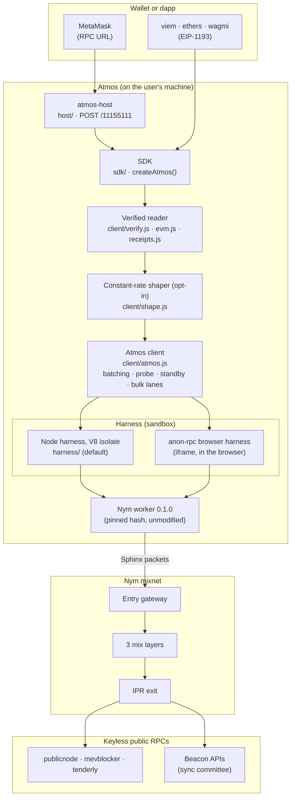
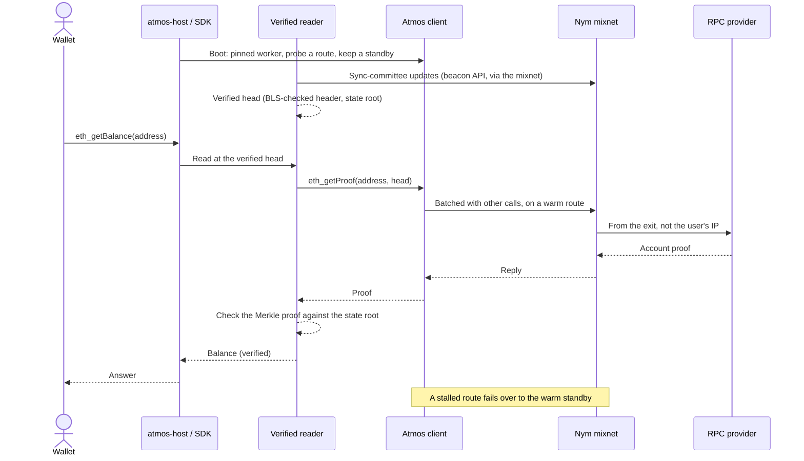

<div align="center">


# Atmos-RPC

### **Private, verified Ethereum RPC over the Nym mixnet: faster than stock anon-rpc, checked against a light client**

<br>

[](./sdk/package.json)
[](https://sepolia.etherscan.io)
[](https://github.com/ethereum/anon-rpc)
[](https://nym.com)
[](#development)
[](#use-it)

<br>

**[Background](#the-background)** · **[What it does](#what-it-does)** · **[Use it](#use-it)** · **[Architecture](#architecture)** · **[Request flow](#request-flow)** · **[Results](#results)** · **[What is verified](#what-is-verified)** · **[Where it lives](#where-it-lives)** · **[Develop](#development)** · **[License](#license)**

<br><br><br>
</div>

**Atmos** is a client layer on top of **[anon-rpc](https://github.com/ethereum/anon-rpc)**, the standard for sending a wallet's Ethereum RPC calls through an anonymity network from inside a sandboxed worker. It runs the **unmodified Nym worker**, pinned by hash, and adds what anon-rpc leaves to the client: **speed** (batching, route probing, a warm standby), **integrity** (every read checked against a light-client head) and **timing privacy** (an optional constant-rate, padded schedule).

You can use it three ways: as an **EIP-1193 provider** for viem, ethers or wagmi; as **`atmos-host`**, a local RPC URL that MetaMask and other wallets can use as-is; or as the lower-level **client** inside your own code.

> ### ⚠️ Sepolia · research software · unaudited
> Atmos runs on **Sepolia only** and has **not been independently audited**. It holds no keys and moves no funds itself, but do not rely on it for the privacy of mainnet activity yet. Timing results are from a small number of Cloud Run sessions; read them as measured, not guaranteed.

---

## The Background

anon-rpc hides **your IP address** from the RPC provider: calls leave from a mixnet exit, not from your machine. That is necessary, but on its own it isn't anonymity:

- **The provider still sees every query.** Which addresses you look up, which contracts you call, and when, is a fingerprint of its own.
- **The provider can lie.** A plain RPC answer is trusted as-is, so a dishonest or compromised provider can show you the wrong balance, nonce or contract state.
- **The timing leaks.** A wallet's burst of reads on page load, and its polling rhythm afterwards, are visible to anyone watching the exit or the provider.
- **It's slow in practice.** A wallet issues reads in parallel. Through one stock Nym worker, each extra concurrent call waits for a fresh TCP and TLS connection through the mixnet, one after another, so a 10-read page load takes 15–22 s.

**Atmos keeps anon-rpc's model and closes these gaps on the client side.**

1. **Faster.** Concurrent calls to a provider leave as **one JSON-RPC batch** on an already-warm connection. A route is trusted only after a real call succeeds through it, and a **warm standby route** takes over when a call stalls.
2. **Verified.** A **light client** follows the sync committee to a verified head. Balances, nonces, code and storage are checked with `eth_getProof` against its state root, `eth_call` runs in a **local EVM on proven state**, and receipts are checked against the block's receipts root.
3. **More private.** An optional **constant-rate, padded schedule** sends the same number of same-sized requests whether the wallet is busy or idle. Routes rotate on a timer, and the worker's code is pinned by hash and limited to the Nym directory and its own gateway.

---

## What it does

- **Batching:** a wallet's 10 parallel reads leave as one batch instead of 10 serial connection setups.
- **Route probing:** a new route through the mixnet must answer a real call before it carries any traffic; routes that report ready but never answer are dropped.
- **Warm standby and failover:** a second route is kept booted and connected to every provider the client has used, and takes over when the primary stalls.
- **Verified reads:** `eth_getBalance`, `eth_getTransactionCount`, `eth_getCode`, `eth_getStorageAt`, `eth_call`, receipts and headers are checked against a light-client head (see [What is verified](#what-is-verified)).
- **Constant-rate shaping (opt-in):** every call waits for a slot on a fixed clock, padded to 2 KB, with dummies in empty slots.
- **Route rotation:** the self-hosted endpoint replaces its route about every 10 minutes, so no route lasts long enough to become a timing fingerprint.
- **A pinned, confined worker:** the Nym worker's hash is pinned (a lying RPC provider can't swap it), the specifier is never read in the clear at start-up, and in the Node harness the worker can reach only the Nym directory and its own entry gateway.
- **EIP-7928 mode (experimental, opt-in):** keeps accounts you have read current from each block's verified access list, so repeat reads name nothing to a provider. It keeps pace in some sessions and not others.

---

## Use it

### A local RPC URL for MetaMask (`atmos-host`)

```sh
curl -fsSL https://atmos.xavio.dev/install.sh | sh
```

The script checks for Node 24 and git, fetches `client/`, `sdk/`, `harness/` and `host/` into `~/.atmos`, builds them from the committed lockfiles, and offers an optional systemd user service. It touches nothing outside that directory unless you agree to the service. Then add a network to MetaMask:

| Field | Value |
|---|---|
| RPC URL | `http://127.0.0.1:8545/11155111` |
| Chain ID | `11155111` |
| Currency | `SepoliaETH` |

The first answer takes 15–70 s while the host joins the mixnet and verifies the chain head. `GET http://127.0.0.1:8545/` reports readiness and how many answers were verified. Settings: `ATMOS_SHAPE=1` (constant-rate schedule), `ATMOS_PREFETCH=1` (re-prove recent reads each block), `ATMOS_BAL=1` (EIP-7928 mode), `ATMOS_CHECKPOINT=0x…` (your own trust anchor), `ATMOS_PUBLIC=1` (serve other hosts). Docker: `docker build -f host/Dockerfile.node -t atmos-host .`

### The SDK: an EIP-1193 provider

```js
import { createAtmos } from "./sdk/node.js";   // sdk/index.js in the browser
import { createPublicClient, custom } from "viem";
import { sepolia } from "viem/chains";

const atmos = createAtmos();
const client = createPublicClient({ chain: sepolia, transport: custom(atmos) });
console.log(await client.getBalance({ address: "0x…" })); // proven against the verified head
atmos.close();
```

Atmos holds no keys: sign with a local account and send raw transactions. Options: `checkpoint`, `shape`, `prefetch`, `bal`, `log`. Not on npm yet; install `sdk/`'s dependencies in place, and build the harness for Node.

### The client directly

```js
import { createAtmosClient } from "./client/atmos.js";

const atmos = await createAtmosClient({ bootstrapProvider, probeUrl: "https://rpc.mevblocker.io" });
const { result } = await atmos.request("https://rpc.mevblocker.io", { jsonrpc: "2.0", id: 1, method: "eth_blockNumber", params: [] });
```

Optional: `rotateMs`, `padBytes`, `hedgeLambdaMs`, `overflow`, `bulkLanes`, `bulkReplace`, `tunnel`, `nymApis`. All are off by default; the benchmark shows which pay.

---

## Architecture



## Request flow



---

## Results

Cloud Run, 3 regions (europe-west1, us-east1, asia-south1), 4 sessions per arm per region, 10-minute sessions, keyless providers. Full tables and the session-level CSV/JSON are on the website's benchmarks page.

| | Stock anon-rpc | Atmos |
|---|---|---|
| 10-read page load (median) | 14.7–22.0 s | **1.5–3.6 s** (5.5–6.6× faster) |
| Slowest 5% of steady calls | 3.2–7.3 s | **0.9–2.7 s** (3–5× lower) |
| Calls answered | 100% (some routes dead) | 99–100% |
| Time to first answer | 16–33 s | 17–71 s (slower: Atmos tests its route first) |

- **Against direct RPC:** Atmos adds about 0.5–0.6 s per call, the mixnet round trip. A verified balance adds about 0.5–0.9 s for its proof. The latest block number is answered from the verified head with no wait.
- **Failover:** when a route stalled, Atmos switched to its standby 15–18 s later and lost only the call in flight.
- **Browser or Node:** the Node harness runs the Nym worker at the same speed as headless Chromium.
- **Timing privacy:** with the constant-rate schedule on, an observer of the host's **outgoing requests** told busy windows from idle ones no better than chance. Replies are not padded, and incoming traffic has not been measured.

---

## What is verified

| Method | How it is answered |
|---|---|
| `eth_chainId`, `net_version` | locally |
| `eth_blockNumber` | the verified head, no request |
| `eth_getBalance`, `eth_getTransactionCount`, `eth_getCode`, `eth_getStorageAt` | `eth_getProof` checked against the head's state root |
| `eth_call` | run in a local EVM on proven state |
| `eth_estimateGas` | the provider's figure, with the call proven not to revert |
| `eth_getTransactionReceipt` | checked against the block's receipts root |
| `eth_getBlockByNumber`, `eth_getBlockByHash` | header proven; the transaction list is the provider's |
| `eth_sendRawTransaction` | sent through the mixnet; the returned hash must match |
| anything else | sent through the mixnet unverified, and counted |

---

## Where it lives

### Routing and transport

| Capability | Code |
|---|---|
| **Batching, route probe, warm standby, failover, rotation** | [`client/atmos.js`](./client/atmos.js) |
| **Pinned worker hash and silent boot** (no specifier read in the clear) | [`client/atmos.js`](./client/atmos.js) (`pinSpecifier`) |
| **Bulk lanes** for large background fetches (access lists) | [`client/atmos.js`](./client/atmos.js) (`bulk`) |
| **Node harness**: the Nym worker in a V8 isolate, with a host allowlist | [`harness/node-harness/`](./harness/node-harness) |

### Verification

| Capability | Code |
|---|---|
| **Light client** (sync committee, BLS) and **proof-checked reads** | [`client/verify.js`](./client/verify.js) |
| **`eth_call` on proven state** (`@ethereumjs/evm`) | [`client/evm.js`](./client/evm.js) |
| **Receipts against the receipts root** | [`client/receipts.js`](./client/receipts.js) |
| **EIP-7928 access-list follower** (experimental) | [`client/bal.js`](./client/bal.js) |

### Privacy and delivery

| Capability | Code |
|---|---|
| **Constant-rate, padded schedule** | [`client/shape.js`](./client/shape.js) |
| **EIP-1193 provider** (browser and Node) | [`sdk/`](./sdk) |
| **Local RPC endpoint** for wallets | [`host/`](./host) |
| **Installer** | [`web/static/install.sh`](./web/static/install.sh) |
| **Cloud Run benchmark** | [`bench/`](./bench) |

---

## Repository layout

```
client/   the Atmos client: routing, batching, failover, verified reads, EVM, receipts, shaping
sdk/      createAtmos(): an EIP-1193 provider for the browser and Node
host/     atmos-host: a local JSON-RPC endpoint for Sepolia (POST /11155111)
harness/  a fork of anon-rpc's Node harness on a V8 isolate, able to run the Nym worker
bench/    the Cloud Run benchmark: stock anon-rpc against each Atmos layer, and offline client tests
web/      the website, docs and in-browser demo (SvelteKit, deployed on Vercel)
```

---

## Development

**Prerequisites:** Node 24 and git. Docker is optional (`host/Dockerfile.node`). The benchmark needs a Google Cloud project (`GCP_PROJECT`).

```sh
# Harness (needed by the host, the SDK in Node, and the bench's Node arm)
cd harness && npm ci && npm run build && npm test

# Host
cd host && npm ci && npm run build && npm start        # http://127.0.0.1:8545/11155111
npm run test:direct                                     # verified reads, eth_call, receipts, tamper cases

# Client: offline behaviour and regression tests
cd bench && npm ci && npm test

# Benchmark: one local session, or Cloud Run in three regions
cd bench && npm run build && ARMS=N1 SESSIONS=1 MINUTES=2 node run.mjs
GCP_PROJECT=<project> bench/deploy-run.sh <tag> <job> D,N0,N1 4 1 europe-west1 us-east1 asia-south1

# Website
cd web && npm ci && npm run check && npm run build
```

Security findings in anon-rpc's worker loading (an unproven worker-hash read, no egress limits in the browser harness, single-key specifier owners) were reported privately to its author. The client-side fixes (the hash pin and the egress allowlist) are in this repository.

---

## License

The SDK is MIT-licensed ([`sdk/package.json`](./sdk/package.json)). The harness fork keeps anon-rpc's MIT licence ([`harness/LICENSE`](./harness/LICENSE)), with its upstream commit in [`harness/UPSTREAM`](./harness/UPSTREAM).

> **Research software:** provided "as is", without warranty of any kind. Atmos has not been independently audited.

---

<br><br>

<div align="center">

<h3>Built By

[Immanuel](https://github.com/xavio2495)

</h3>
</div>
